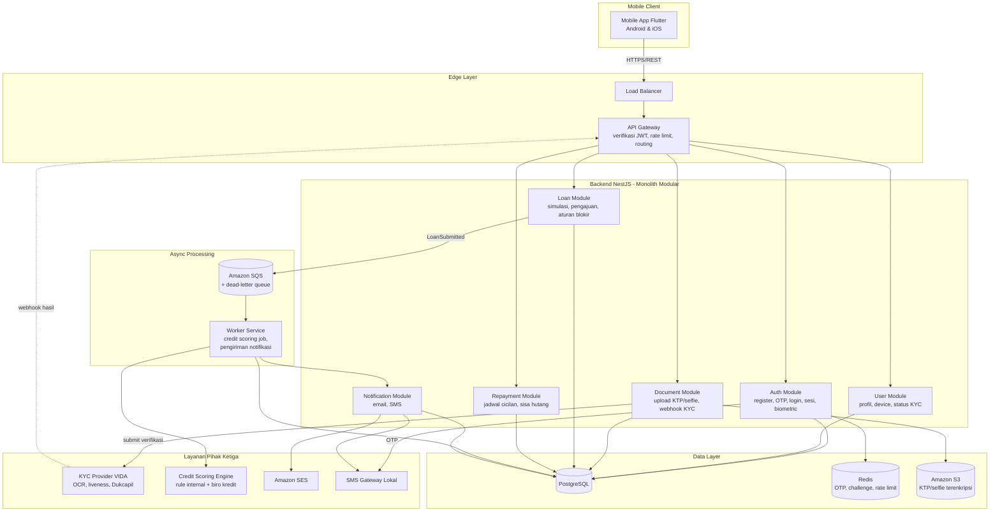

# High-Level Architecture

## Diagram

## Komponen Utama

| Komponen | Tanggung Jawab |
|---|---|
| **Mobile App (Flutter)** | UI, kamera untuk KTP/selfie, biometric prompt lokal, menyimpan token di secure storage |
| **Load Balancer** | Membagi traffic ke beberapa instance backend dan mengalihkan traffic jika satu instance mati |
| **API Gateway** | Pintu masuk tunggal: verifikasi JWT, rate limiting, routing ke modul backend |
| **Auth Module** | Registrasi, OTP, onboarding token, login password, refresh/logout, challenge dan verifikasi biometric, lupa password |
| **User Module** | Profil user, device untuk biometric, status KYC |
| **Document Module** | Upload KTP/selfie ke S3, mengirim ke provider KYC, menerima webhook hasil verifikasi |
| **Loan Module** | Simulasi cicilan, pengajuan, aturan "satu pinjaman berjalan", publish event ke queue |
| **Repayment Module** | Jadwal cicilan, sisa hutang, tagihan bulan berjalan |
| **Notification Module** | Mengirim notifikasi hasil pengajuan (disetujui/ditolak) via email dan SMS, serta mencatat status pengiriman |
| **Message Queue + Worker** | Menjalankan credit scoring dan pengiriman notifikasi di luar request user, dengan retry dan dead-letter queue |
| **Credit Scoring Engine** | Menentukan disetujui/ditolak dari data profil (umur, pekerjaan, penghasilan) dan data biro kredit |
| **Object Storage** | Menyimpan file KTP dan selfie, terenkripsi, diakses lewat signed URL |

## Alasan Desain

- **Scoring dan KYC asinkron.** Keduanya bergantung pada pihak ketiga yang bisa lambat atau down. `POST /loans` langsung membalas `202` dengan status `SUBMITTED`, dan KYC membalas `202` lalu hasilnya datang lewat webhook. User tidak menunggu dengan koneksi terbuka, dan kegagalan provider di-retry dari queue.
- **API Gateway** sebagai satu pintu masuk memusatkan autentikasi dan rate limiting, penting untuk aplikasi fintech yang rawan brute force dan fraud.
- **Object storage terpisah dari database** untuk file KTP/selfie: lebih murah, mudah di-scale, dan akses ke data sensitif bisa dikontrol terpisah.
- **Monolith modular** dipilih karena skala awal belum butuh kompleksitas microservices. Modul dipisah secara logis sehingga bisa diangkat menjadi service sendiri saat skala bertambah. Worker sudah terpisah sejak awal karena pola bebannya berbeda.
