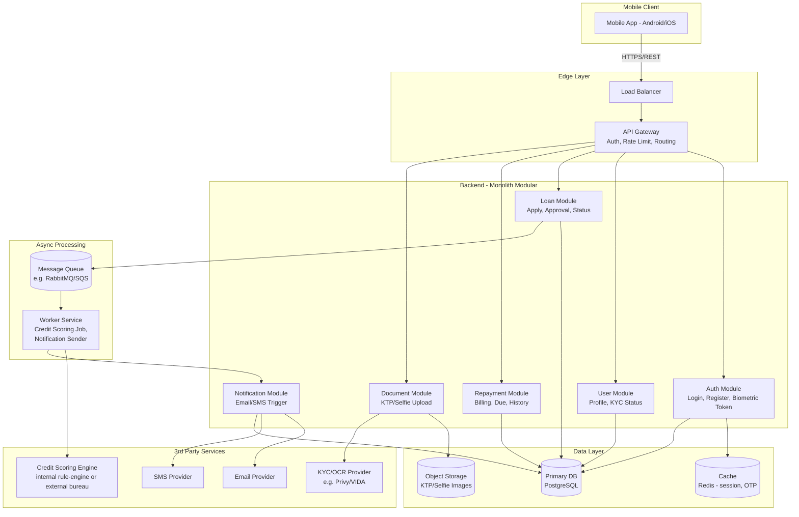

# High-Level Architecture

## Diagram

## Komponen Utama

| Komponen | Tanggung Jawab |
|---|---|
| **Mobile App** | Native/cross-platform app (Flutter/React Native), menyimpan token sesi, biometric prompt lokal |
| **API Gateway** | Single entry point: autentikasi token (JWT), rate limiting, routing ke modul backend |
| **Auth Module** | Register, login (password + biometric token exchange), OTP verifikasi email/telepon |
| **Document Module** | Upload foto diri + KTP, kirim ke KYC provider untuk OCR & liveness check |
| **User Module** | Data profil user, status KYC |
| **Loan Module** | Pengajuan pinjaman, cek eligibility (ada pinjaman aktif/tidak), trigger proses scoring |
| **Repayment Module** | Kalkulasi tagihan bulanan, sisa hutang, histori pembayaran |
| **Notification Module** | Mengirim notifikasi hasil pengajuan via email & SMS |
| **Message Queue + Worker** | Memproses credit scoring secara async (tidak blocking request), mengirim notifikasi async |
| **Credit Scoring Engine** | Menentukan diterima/ditolak berdasarkan rule/skor kredit |
| **Object Storage** | Penyimpanan file foto KTP & selfie (terenkripsi, akses terbatas) |

## Alasan Desain

- **Async untuk proses scoring**: pengajuan pinjaman tidak selalu instan (tergantung 3rd party), sehingga request `POST /loans` langsung return `PENDING` dan status final diupdate lewat worker + push notifikasi.
- **API Gateway** sebagai satu pintu masuk memudahkan pengelolaan autentikasi & rate limiting, penting untuk aplikasi fintech yang rawan abuse (fraud, brute force).
- **Object Storage terpisah dari DB utama** untuk file KTP/selfie — lebih murah, scalable, dan memudahkan kontrol akses/enkripsi data sensitif secara terpisah.
- **Monolith modular** dipilih karena skala awal startup fintech belum butuh kompleksitas microservices; modul tetap dipisah secara logis agar mudah di-extract jadi service independen saat scale bertambah.
