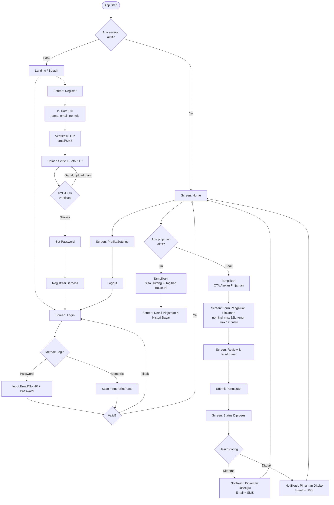

# Screen Flow

## Catatan Flow

- **Blocked state**: tombol "Ajukan Pinjaman" di screen `HomeActive` otomatis disabled (dengan tooltip "Lunasi dulu pinjaman berjalan") selama `LoanStatusCheck` bernilai aktif (ada pinjaman belum lunas), sesuai requirement "User tidak dapat melakukan peminjaman jika sedang ada proses peminjaman dan belum dilunaskan". Ini state di dalam screen Home, bukan screen terpisah.
- **Processing screen**: karena hasil scoring bisa async (lihat [architecture](../01-architecture/high-level-architecture.md)), screen ini bisa menunggu dengan polling/push, atau user boleh keluar dan menerima notifikasi push/email/SMS saat hasil sudah ada.
- **Urutan OTP sebelum upload KTP**: OTP memverifikasi kepemilikan email/nomor telepon terlebih dulu, baru lanjut upload dokumen identitas. Dengan urutan ini, jika KYC/OCR gagal (foto blur, data tidak cocok, dll), user cukup diarahkan ulang ke `UploadDoc` → `KYCCheck` tanpa perlu mengulang verifikasi OTP yang sudah berhasil.
