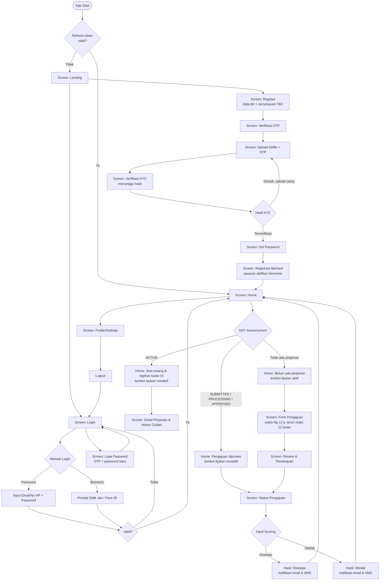

# Screen Flow

## Catatan Flow

- **Aturan blokir pinjaman.** Brief menyebut user tidak bisa meminjam jika "sedang ada proses peminjaman dan belum dilunaskan". Karena itu Home punya tiga varian, dan tombol Ajukan nonaktif di dua di antaranya:

  | Varian Home | Status LOAN | Tombol Ajukan | Teks bantu di bawah tombol |
  |---|---|---|---|
  | Belum ada pinjaman | tidak ada, `REJECTED`, atau `PAID_OFF` | Aktif | - |
  | Pengajuan diproses | `SUBMITTED`, `PROCESSING`, `APPROVED` | Nonaktif | "Pengajuanmu sedang diproses" |
  | Pinjaman aktif | `ACTIVE` | Nonaktif | "Lunasi pinjaman berjalan untuk mengajukan lagi" |

  Status ini dibaca dari `GET /loans/current` (field `can_apply` dan `blocked_reason`). Server tetap menolak dengan `409` jika app mengirim pengajuan saat tidak boleh, misalnya dari device lain.
- **Urutan registrasi.** Data diri, lalu OTP, upload dokumen, KYC, dan set password. OTP diverifikasi lebih dulu untuk memastikan nomor milik user sebelum menerima data KTP. Setelah OTP valid, server memberi onboarding token, sehingga jika KYC gagal user cukup upload ulang tanpa mengulang OTP.
- **KYC asinkron.** Verifikasi bisa butuh waktu. Screen Verifikasi KYC menunggu dengan polling. Jika user menutup app, registrasi bisa dilanjutkan dari langkah terakhir (lihat [screen behavior](../05-screen-behavior/screen-behavior.md)).
- **Status Pengajuan.** Scoring berjalan asinkron (lihat [arsitektur](../01-architecture/high-level-architecture.md)). User boleh keluar dari screen ini dan akan menerima notifikasi email dan SMS saat hasil keluar.
