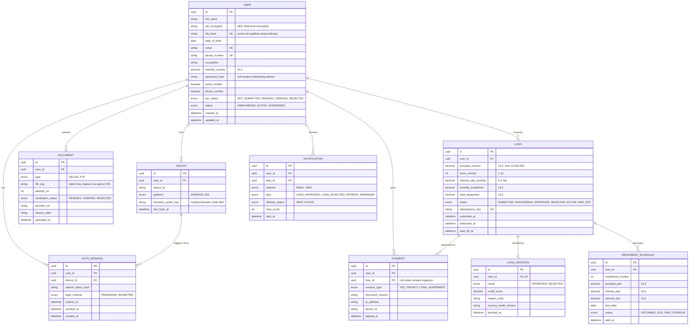

# Entity Relationship Diagram



## Aturan Bisnis di Level Data

**1. Satu pinjaman berjalan per user.** Pinjaman dianggap masih berjalan jika berstatus `SUBMITTED`, `PROCESSING`, `APPROVED`, atau `ACTIVE`. Sesuai brief: user tidak bisa meminjam selama ada pengajuan yang diproses **atau** pinjaman yang belum lunas. Aturan ini dijaga di dua lapis:

```sql
-- cek di aplikasi sebelum insert
SELECT 1 FROM loan
WHERE user_id = :user_id
  AND status IN ('SUBMITTED', 'PROCESSING', 'APPROVED', 'ACTIVE');

-- pengaman terakhir di database: dua request bersamaan tidak bisa sama-sama lolos
CREATE UNIQUE INDEX uq_loan_one_open_per_user
  ON loan (user_id)
  WHERE status IN ('SUBMITTED', 'PROCESSING', 'APPROVED', 'ACTIVE');
```

**2. Syarat mengajukan pinjaman.** `USER.status = ACTIVE` dan `USER.kyc_status = VERIFIED`.

**3. Jadwal cicilan.** `REPAYMENT_SCHEDULE` dibuat saat `LOAN` menjadi `APPROVED`, sebanyak `tenor_months` baris. Dengan bunga flat: `interest_part = principal_amount × interest_rate_monthly`, `principal_part = principal_amount / tenor_months`.

**4. Lunas.** Saat semua cicilan berstatus `PAID`, `LOAN.status` menjadi `PAID_OFF` dan user bisa mengajukan lagi.

## Catatan Desain

- **`LOAN_DECISION` dipisah dari `LOAN`** (relasi 1 ke 0..1) supaya data hasil scoring, yaitu skor, reason code, dan versi model, tersimpan utuh untuk audit dan sengketa, tanpa membebani tabel transaksi utama. Waktu keputusan hanya disimpan di `LOAN_DECISION.decided_at`.
- **`DEVICE` menyimpan public key biometric per perangkat**, bukan per user, karena satu user bisa punya lebih dari satu HP dan biometric terikat ke hardware.
- **`CONSENT` mencatat persetujuan** syarat dan ketentuan saat registrasi dan perjanjian pinjaman saat pengajuan, lengkap dengan versi dokumen, waktu, IP, dan device. Ini bukti audit yang dibutuhkan untuk kepatuhan perlindungan data pribadi dan regulasi fintech lending.
- **NIK dienkripsi di level field.** `nik_hash` dipakai untuk cek duplikasi tanpa perlu mendekripsi.
- **Foto KTP dan selfie** disimpan di object storage. Database hanya menyimpan `file_key`, dan akses file memakai signed URL berumur pendek.
- **Pembayaran cicilan** berada di luar scope (lihat README). Diasumsikan sistem pembayaran eksternal mengubah `REPAYMENT_SCHEDULE.status` menjadi `PAID` dan mengisi `paid_at`.
