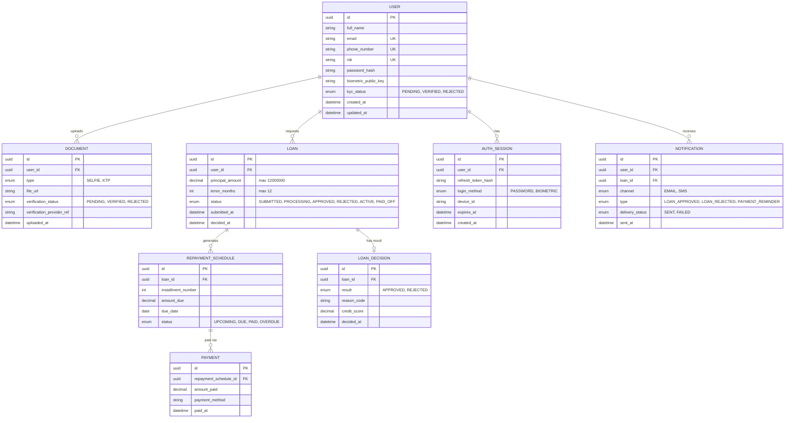

# Entity Relationship Diagram

## Catatan

- `USER.kyc_status` harus `VERIFIED` sebelum user bisa mengajukan pinjaman (`LOAN`).
- Constraint bisnis "tidak boleh pinjam jika ada pinjaman aktif" divalidasi di level aplikasi: cek apakah ada `LOAN` milik user dengan status `APPROVED`/`ACTIVE` sebelum mengizinkan `INSERT` baru.
- `LOAN_DECISION` dipisah dari `LOAN` agar histori keputusan scoring (termasuk reason code & score) tidak bercampur dengan data pengajuan, dan memudahkan audit trail.
- `REPAYMENT_SCHEDULE` di-generate otomatis saat `LOAN.status = APPROVED`, berdasarkan `principal_amount` dan `tenor_months`.
