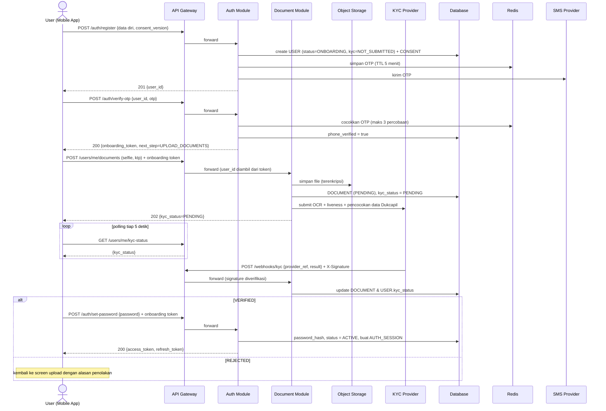
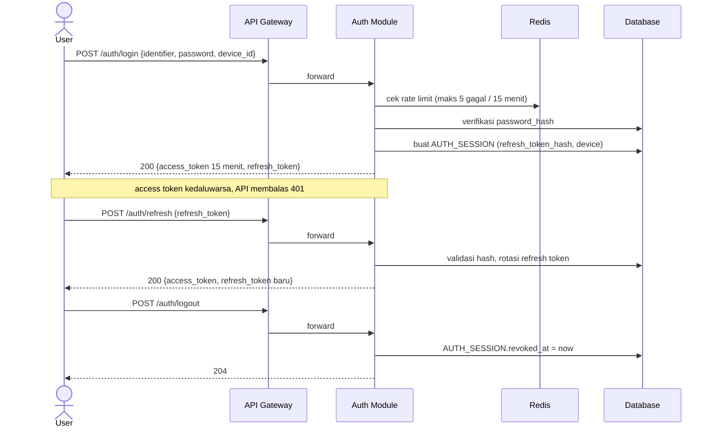
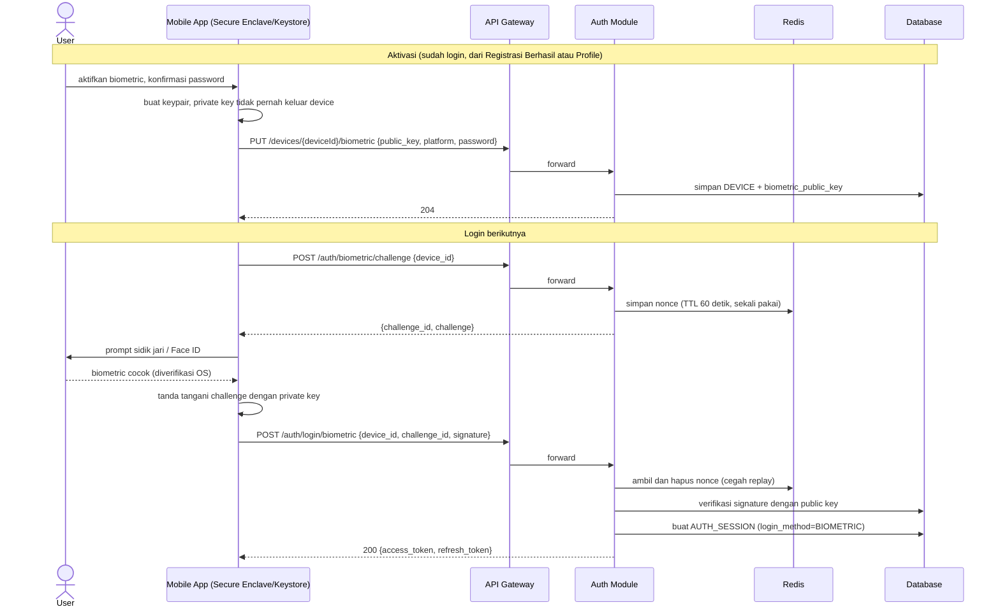
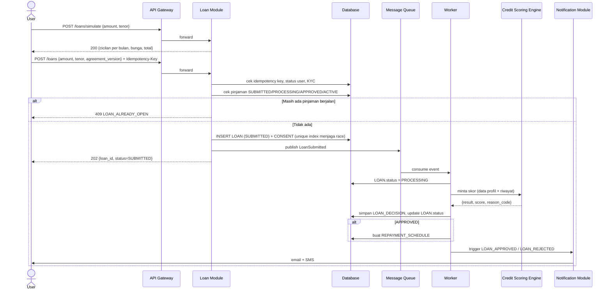
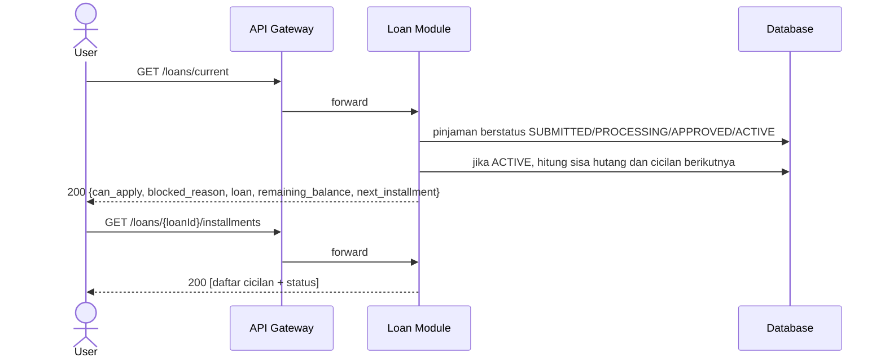
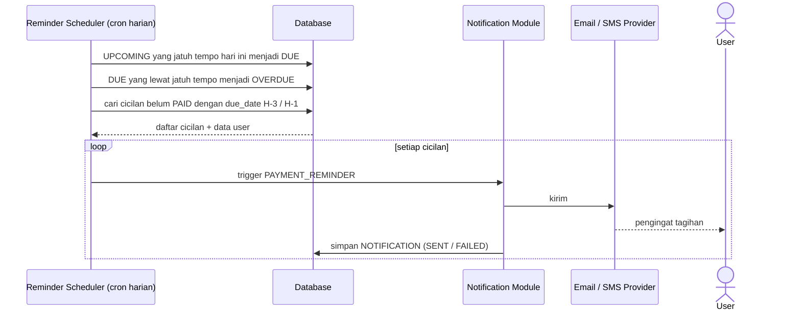

# API Sequence Diagrams

Spesifikasi lengkap tiap endpoint ada di [api-spec.yaml](api-spec.yaml). State dan aturan pengajuan pinjaman ada di [loan-state-and-rules.md](loan-state-and-rules.md).

## 1. Registrasi: Data Diri → OTP → Upload KTP + KYC → Set Password

## 2. Login Password, Refresh, dan Logout

Access token berupa JWT stateless dan diverifikasi oleh API Gateway. Refresh token disimpan ter-hash di `AUTH_SESSION` supaya sesi bisa dicabut per device. Redis hanya dipakai untuk OTP, challenge biometric, dan rate limit.

## 3. Aktivasi dan Login Biometric

## 4. Pengajuan Pinjaman

## 5. Home: Status Pinjaman, Sisa Hutang, dan Tagihan

## 6. Reminder dan Status Jatuh Tempo

