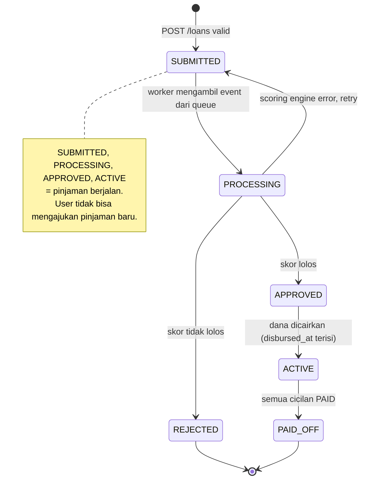
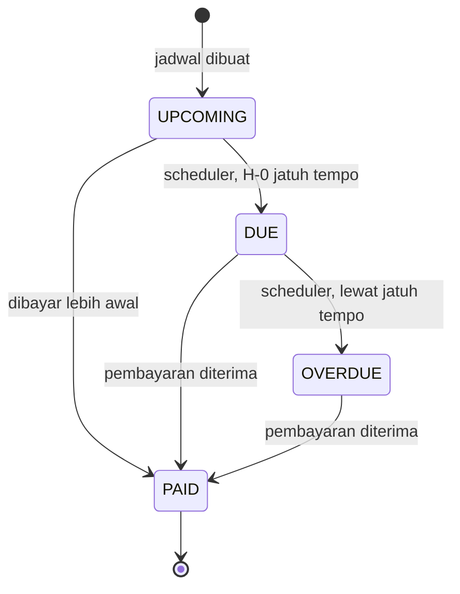
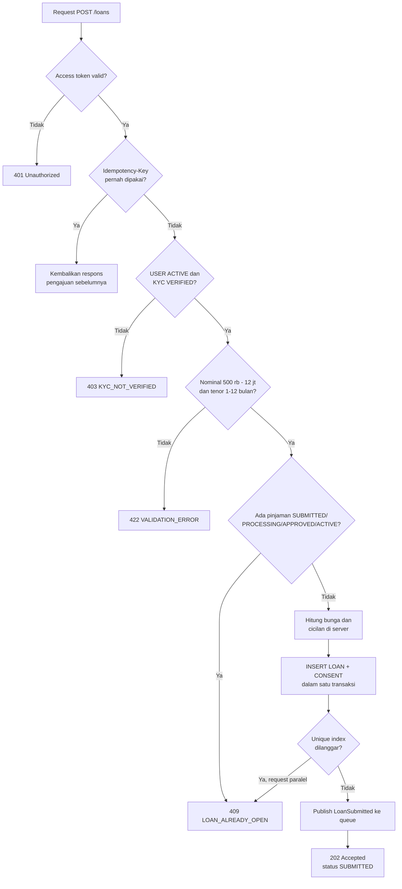

# Loan State Diagram & Aturan Pengajuan

## 1. State Diagram LOAN

| Transisi | Pemicu | Efek samping |
|---|---|---|
| `[*] → SUBMITTED` | `POST /loans` lolos validasi | Simpan `LOAN` + `CONSENT` (perjanjian pinjaman), publish event `LoanSubmitted` |
| `SUBMITTED → PROCESSING` | Worker mengambil event | Panggil credit scoring engine |
| `PROCESSING → APPROVED` | Hasil scoring lolos | Simpan `LOAN_DECISION`, buat `REPAYMENT_SCHEDULE`, kirim notifikasi disetujui (email, SMS) |
| `PROCESSING → REJECTED` | Hasil scoring tidak lolos | Simpan `LOAN_DECISION`, kirim notifikasi ditolak |
| `PROCESSING → SUBMITTED` | Scoring engine timeout/error | Retry dengan backoff, maksimal 3 kali, lalu masuk dead-letter queue untuk ditangani tim operasional |
| `APPROVED → ACTIVE` | Pencairan dana berhasil | Isi `disbursed_at`, tanggal jatuh tempo cicilan dihitung dari tanggal ini |
| `ACTIVE → PAID_OFF` | Cicilan terakhir `PAID` | Isi `paid_off_at`, user bisa mengajukan lagi |

## 2. State Diagram Cicilan (REPAYMENT_SCHEDULE)

Perubahan status `DUE` dan `OVERDUE` dilakukan oleh scheduler yang berjalan harian. Scheduler yang sama mengirim reminder H-3 dan H-1. Perubahan ke `PAID` datang dari sistem pembayaran eksternal (di luar scope).

## 3. Flowchart Validasi `POST /loans`

Cek pinjaman berjalan dilakukan dua kali dengan sengaja: query di aplikasi memberi pesan error yang jelas, sedangkan partial unique index menjamin aturan tetap benar ketika dua request datang bersamaan, misalnya dari dua device.

## 4. Rumus Cicilan (Asumsi)

Bunga **flat** per bulan, nilainya dikonfigurasi oleh bisnis dan wajib mengikuti batas manfaat ekonomi dari OJK.

| Komponen | Rumus | Contoh: Rp 6.000.000, 6 bulan, bunga 1,5% |
|---|---|---|
| Bunga per bulan | pokok × bunga | Rp 90.000 |
| Pokok per bulan | pokok ÷ tenor | Rp 1.000.000 |
| Cicilan per bulan | pokok per bulan + bunga per bulan | Rp 1.090.000 |
| Total pengembalian | cicilan × tenor | Rp 6.540.000 |

Semua angka dihitung di server (`POST /loans/simulate`) supaya app dan backend tidak pernah berbeda hasil.
